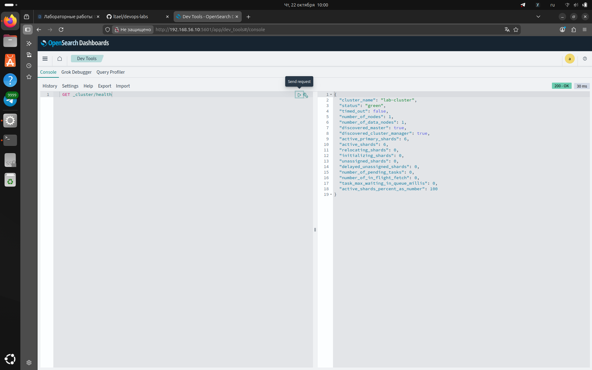
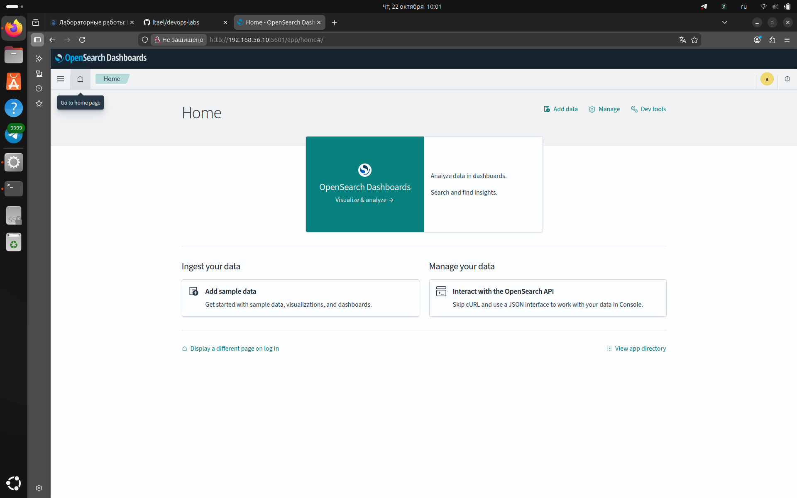
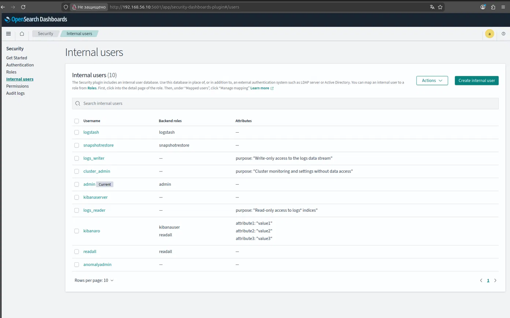

# Лабораторная работа №1 — Ansible-роль для OpenSearch

## Цель

Разработать Ansible-роль для установки и настройки OpenSearch и OpenSearch Dashboards 3.8
в режиме single-node на удалённой Linux-машине: установка выбранной версии, настройка системы
и сервиса, запуск, автоматическое применение изменений конфигурации и проверка готовности через API.

## Окружение

| Компонент | Версия / значение |
|---|---|
| Управляющая машина | ноутбук, Ubuntu 24.04.4 LTS |
| VirtualBox | 7.2.22 |
| Vagrant | 2.4.9 |
| Ansible | ansible-core 2.21.5 |
| Python | 3.12.3 |
| Целевая машина | ВМ Ubuntu 24.04 (образ `bento/ubuntu-24.04`), 2 CPU, 4 ГБ RAM, IP `192.168.56.10` |
| OpenSearch / OpenSearch Dashboards | 3.8.0 |

Целевая машина — виртуальная машина VirtualBox, созданная через Vagrant (`Vagrantfile` в корне репозитория).
Ansible подключается к ней по SSH, как к удалённому серверу. Docker и другие контейнеры не используются.

## Структура репозитория

```
Vagrantfile                      описание тестовой ВМ
ansible.cfg                      настройки Ansible (inventory, roles_path)
.yamllint                        правила yamllint, совместимые с ansible-lint
playbook.yml                     вызывает роль opensearch на группе хостов opensearch
inventory/
  hosts.yml                      список хостов
  group_vars/opensearch/
    main.yml                     связывает пароль из Vault с переменной роли
    vault.yml                    пароль admin, зашифрован Ansible Vault
roles/opensearch/                роль
docs/                            выводы команд и скриншоты для отчёта
```

## Роль opensearch

Сторонние роли не используются. Установка выполняется из официальных архивов tar.gz
(в них уже есть JDK для OpenSearch и Node.js для Dashboards).

| Директория | Содержимое |
|---|---|
| `defaults/` | параметры, которые пользователь может переопределить |
| `vars/` | внутренние значения: пути установки, ссылки на архивы, список пакетов, архитектура |
| `tasks/` | `main.yml` и шаги: `preflight`, `system`, `install`, `config`, `service`, `healthcheck`, `dashboards` |
| `handlers/` | применение sysctl, `daemon-reload`, перезапуск OpenSearch и Dashboards |
| `templates/` | `opensearch.yml`, `heap.options`, `opensearch_dashboards.yml`, unit-файлы systemd обеих служб |
| `files/` | `99-opensearch.conf` с `vm.max_map_count` |
| `meta/` | описание роли, минимальная версия Ansible, поддерживаемые платформы |

### Как работает роль

1. **preflight** — проверяет, что задан пароль admin и корректный размер heap; без них роль останавливается сразу.
2. **system** — ставит зависимости, создаёт системного пользователя и группу `opensearch`,
   копирует `99-opensearch.conf` (`vm.max_map_count = 262144`) и сразу применяет его через handler
   (`flush_handlers`), до первого запуска OpenSearch.
3. **install** — создаёт каталоги данных и логов, скачивает архив с проверкой SHA-512, распаковывает его
   в `/opt/opensearch-<версия>` и делает ссылку `/opt/opensearch`. При смене версии новая распаковывается
   рядом, ссылка переключается, handler перезапускает службу. Данные хранятся отдельно в `/var/lib/opensearch`.
   Затем один раз выполняется демо-скрипт security-плагина: он создаёт TLS-сертификаты и задаёт пароль admin.
4. **config** — формирует `opensearch.yml` и `jvm.options.d/heap.options` из шаблонов Jinja2.
   При изменении любого из них срабатывает handler `Restart opensearch`.
5. **service** — устанавливает unit-файл systemd (лимиты `LimitNOFILE`, `LimitMEMLOCK`), выполняет отложенные
   handlers и включает службу с автозапуском (`enabled: true`). Благодаря `flush_handlers` перед `started`
   при первом запуске служба стартует один раз, без лишнего перезапуска.
6. **healthcheck** — проверяет готовность через `GET _cluster/health`: до 30 попыток с паузой 10 секунд,
   статус должен быть `green` или `yellow`. Если не дождались — роль завершается с ошибкой.
7. **dashboards** — аналогично ставит OpenSearch Dashboards под отдельным пользователем, формирует конфиг
   и unit-файл, включает автозапуск и проверяет `/api/status` с ограниченным числом попыток.

Повторный запуск роли ничего не меняет (`changed=0`) и не перезапускает службы.
Код проверен линтерами: `yamllint` — без замечаний, `ansible-lint` — `Passed` (профиль `production`).

## Параметры роли

Все параметры задаются в `roles/opensearch/defaults/main.yml` и переопределяются через inventory,
`group_vars` или `-e` без правки задач и шаблонов.

| Параметр | По умолчанию | Почему вынесен |
|---|---|---|
| `opensearch_version` | `3.8.0` | обновление версии без изменения задач |
| `opensearch_dashboards_version` | `3.8.0` | версия Dashboards должна совпадать с версией OpenSearch |
| `opensearch_install_root` | `/opt` | в разных организациях свои стандарты размещения ПО |
| `opensearch_data_dir` | `/var/lib/opensearch` | данные часто выносят на отдельный диск |
| `opensearch_log_dir` | `/var/log/opensearch` | логи могут собираться из другого каталога |
| `opensearch_user` / `opensearch_group` | `opensearch` | имя служебной учётной записи может быть регламентировано |
| `opensearch_dashboards_user` | `opensearch-dashboards` | то же для Dashboards |
| `opensearch_cluster_name` | `lab-cluster` | имя кластера различается между окружениями |
| `opensearch_node_name` | имя хоста из inventory | уникальное имя узла без ручной настройки |
| `opensearch_network_host` | `0.0.0.0` | интерфейс, на котором слушает API; в лабе нужен доступ с управляющей машины |
| `opensearch_http_port` | `9200` | порт может быть занят или стандартизирован иначе |
| `opensearch_heap_size` | `1g` | зависит от объёма памяти машины (рекомендуется не больше половины RAM) |
| `opensearch_memory_lock` | `true` | запрет вытеснения памяти JVM в swap; на некоторых системах отключают |
| `opensearch_extra_config` | `{}` | любые дополнительные настройки `opensearch.yml` без правки шаблона |
| `opensearch_admin_password` | пусто | секрет, задаётся только через Ansible Vault; пустое значение останавливает роль |
| `opensearch_dashboards_host` | `0.0.0.0` | интерфейс веб-интерфейса Dashboards |
| `opensearch_dashboards_port` | `5601` | порт может быть занят |
| `opensearch_dashboards_server_user` / `_password` | `kibanaserver` | служебная учётная запись Dashboards из демо-конфигурации |
| `opensearch_healthcheck_retries` | `30` | время старта зависит от мощности машины |
| `opensearch_healthcheck_delay` | `10` | пауза между попытками проверки, секунды |
| `opensearch_healthcheck_accepted_statuses` | `[green, yellow]` | `yellow` допустим для single-node, где реплики размещать негде |

## Безопасность

Пароль пользователя admin хранится в `inventory/group_vars/opensearch/vault.yml`, зашифрованном
Ansible Vault; пароль от Vault в репозиторий не добавлен. Задачи, работающие с паролем, помечены
`no_log: true`, поэтому пароль не попадает в вывод Ansible.

Используются демо-сертификаты security-плагина OpenSearch и стандартный пароль служебного
пользователя `kibanaserver`. Это допустимо для учебного стенда; ролевая модель с отдельными
пользователями настраивается в лабораторной работе №2 (см. ниже).

## Запуск

```bash
vagrant up                                         # создать и запустить ВМ
ansible all -m ping                                # проверить доступ по SSH
ansible-vault create inventory/group_vars/opensearch/vault.yml
# внутри: vault_opensearch_admin_password: "<надёжный пароль>"
ansible-playbook playbook.yml --ask-vault-pass     # применить роль
```

## Результаты проверки

### Первый запуск на чистой ВМ

```
PLAY RECAP *********************************************************************
opensearch1                : ok=30   changed=23   unreachable=0    failed=0    skipped=0    rescued=0    ignored=0
```

Полный вывод: [docs/run1.txt](docs/run1.txt).

### Повторный запуск — идемпотентность

```
PLAY RECAP *********************************************************************
opensearch1                : ok=23   changed=0    unreachable=0    failed=0    skipped=2    rescued=0    ignored=0
```

`changed=0`: роль ничего не меняет и не перезапускает службы. `skipped=2` — задачи распаковки архивов,
пропущенные благодаря `creates:`. Полный вывод: [docs/run2.txt](docs/run2.txt).

### GET _cluster/health

```bash
curl -sk -u admin "https://192.168.56.10:9200/_cluster/health?pretty"
```

```json
{
  "cluster_name" : "lab-cluster",
  "status" : "green",
  "timed_out" : false,
  "number_of_nodes" : 1,
  "number_of_data_nodes" : 1,
  "discovered_master" : true,
  "discovered_cluster_manager" : true,
  "active_primary_shards" : 5,
  "active_shards" : 5,
  "relocating_shards" : 0,
  "initializing_shards" : 0,
  "unassigned_shards" : 0,
  "delayed_unassigned_shards" : 0,
  "number_of_pending_tasks" : 0,
  "number_of_in_flight_fetch" : 0,
  "task_max_waiting_in_queue_millis" : 0,
  "active_shards_percent_as_number" : 100.0
}
```

Кластер в статусе `green`, один узел — режим single-node.

### Версия OpenSearch

```bash
curl -sk -u admin "https://192.168.56.10:9200/"
```

```json
{
  "name" : "opensearch1",
  "cluster_name" : "lab-cluster",
  "cluster_uuid" : "wwVMpJRGSLCyO7uydmwjRw",
  "version" : {
    "distribution" : "opensearch",
    "number" : "3.8.0",
    "build_type" : "tar",
    "build_hash" : "e5a3c5691be87af6c12dbe3e158c59c04ee72973",
    "build_date" : "2026-08-01T18:48:00.452816924Z",
    "build_snapshot" : false,
    "lucene_version" : "10.5.0",
    "minimum_wire_compatibility_version" : "2.19.0",
    "minimum_index_compatibility_version" : "2.0.0"
  },
  "tagline" : "The OpenSearch Project: https://opensearch.org/"
}
```

Установлена заданная версия `3.8.0` из архива (`build_type: tar`).

### Handlers: перезапуск только при изменении конфигурации

```bash
ansible-playbook playbook.yml --ask-vault-pass -e opensearch_heap_size=1536m
```

```
TASK [opensearch : Render JVM heap options] ************************************
changed: [opensearch1]
--
RUNNING HANDLER [opensearch : Restart opensearch] ******************************
changed: [opensearch1]
--
PLAY RECAP *********************************************************************
opensearch1                : ok=24   changed=2    unreachable=0    failed=0    skipped=2    rescued=0    ignored=0
```

Изменился только параметр heap: изменилась одна задача, сработал один handler перезапуска OpenSearch,
Dashboards не перезапускался (`changed=2` — шаблон и handler). Полный вывод: [docs/run-handler.txt](docs/run-handler.txt).

### Автозапуск после перезагрузки ВМ

```bash
vagrant ssh -c "systemctl is-enabled opensearch opensearch-dashboards"
```

```
enabled
enabled
```

После перезагрузки ВМ (`vagrant reload`) без запуска Ansible:

```json
{
  "cluster_name" : "lab-cluster",
  "status" : "green",
  "timed_out" : false,
  "number_of_nodes" : 1,
  "number_of_data_nodes" : 1,
  "discovered_master" : true,
  "discovered_cluster_manager" : true,
  "active_primary_shards" : 5,
  "active_shards" : 5,
  "relocating_shards" : 0,
  "initializing_shards" : 0,
  "unassigned_shards" : 0,
  "delayed_unassigned_shards" : 0,
  "number_of_pending_tasks" : 0,
  "number_of_in_flight_fetch" : 0,
  "task_max_waiting_in_queue_millis" : 0,
  "active_shards_percent_as_number" : 100.0
}
```

Обе службы включены в автозагрузку, после перезагрузки кластер поднялся сам и находится в статусе `green`.

### OpenSearch Dashboards

`GET _cluster/health` в Dev Tools (`http://192.168.56.10:5601`, вход под пользователем admin):



Главная страница Dashboards:



## Выводы

Разработана Ansible-роль без сторонних ролей, которая устанавливает OpenSearch и OpenSearch Dashboards 3.8.0
в режиме single-node из официальных архивов, настраивает систему (параметры ядра, лимиты, служебные пользователи)
и службы systemd. Проверено: кластер в статусе `green`, роль идемпотентна (`changed=0` при повторном запуске),
службы перезапускаются только при изменении конфигурации, стартуют автоматически после перезагрузки,
а готовность проверяется через API с ограниченным числом попыток. В лабораторной работе №2 роль будет
расширена настройкой безопасности через Security REST API и автотестами Molecule.

---

# Лабораторная работа №2 — тестирование роли с Molecule

## Цель

Расширить роль `opensearch` настройкой безопасности через Security REST API (шаблон индекса для data stream
`logs`, три роли, три пользователя и привязки ролей) и покрыть роль автоматическими тестами в Molecule.

## Окружение

Дополнительно к окружению лабораторной №1:

| Компонент | Версия / значение |
|---|---|
| Molecule | 26.10.0 |
| molecule-plugins (драйвер vagrant) | 26.11.0 |
| Тестовая ВМ Molecule | `opensearch-molecule`, образ `bento/ubuntu-24.04`, 2 CPU, 4 ГБ RAM, VirtualBox |

## Ролевая модель

| Пользователь | Роль | Права | Чего нет |
|---|---|---|---|
| `logs_writer` | `lab_logs_writer` | `indices:data/write/index`, `indices:data/write/bulk*` на `logs` и `.ds-logs-*`; `indices:data/write/bulk` на уровне кластера | чтения, поиска, мониторинга и управления кластером |
| `logs_reader` | `lab_logs_reader` | группа действий `read` на `logs*` и `.ds-logs-*` | записи, удаления, доступа к другим индексам, прав на кластер |
| `cluster_admin` | `lab_cluster_admin` | `cluster_monitor` (состояние, настройки, версия), `cluster:admin/settings/update` | любых прав на индексы |

Обоснование решений:

- **`.ds-logs-*`.** Data stream `logs` хранит документы в скрытых служебных индексах `.ds-logs-000001` и т.д.
  Права на них нужны, чтобы запись и чтение через имя `logs` доходили до данных. Это по-прежнему только data stream `logs`.
- **`indices:data/write/bulk` у писателя.** В OpenSearch пакетная запись формально проверяется на уровне кластера,
  хотя это запись данных, а не управление кластером. Отсутствие у писателя остальных кластерных прав подтверждено
  тестом: `GET _cluster/health` под ним возвращает `403`.
- **Data stream создаётся ролью под admin.** Поэтому писателю не нужно право создавать индексы.
- **Префикс `lab_` у ролей** исключает совпадение со встроенными ролями OpenSearch.
- **Права ролей во `vars/`, а не в `defaults/`**: они заданы условием работы и не должны меняться пользователем роли.

## Шаблон индекса для data stream `logs`

Файл `templates/logs-index-template.json.j2` (Jinja2):

- `index_patterns: ["logs"]` и `data_stream: {}` — индекс `logs` создаётся как data stream;
- `number_of_shards: 1`, `number_of_replicas: 0` — на одном узле реплики разместить негде, с ними кластер был бы `yellow`;
- явный маппинг полей `@timestamp` (date), `message` (text), `level` и `service` (keyword) и `dynamic: false` —
  незнакомые поля сохраняются, но не меняют схему, поэтому писателю не нужны права на изменение маппинга;
- `version` — номер версии шаблона, по нему роль решает, нужно ли его обновлять.

## Изменения в роли

| Файл | Что добавлено |
|---|---|
| `defaults/main.yml` | параметры data stream, пароли (пустые по умолчанию) и список пользователей с ролями |
| `vars/main.yml` | адрес API и описание прав трёх ролей |
| `tasks/preflight.yml` | проверка, что всем пользователям задан пароль не короче 8 символов |
| `tasks/security.yml` | шаблон индекса, data stream, роли, пользователи, role mapping через REST API |
| `tasks/main.yml` | подключение `security.yml` после проверки готовности и до Dashboards |
| `templates/logs-index-template.json.j2` | шаблон индекса для data stream |
| `meta/main.yml` | `namespace: ltael` — полное имя роли, которого требует Molecule |
| `tasks/install.yml`, `tasks/dashboards.yml` | архивы хранятся в `/opt` вместо `/tmp`, чтобы не скачиваться заново после перезагрузки ВМ |
| `molecule/default/` | сценарий Molecule и автотесты |

### Новые параметры

| Параметр | По умолчанию | Почему вынесен |
|---|---|---|
| `opensearch_logs_data_stream` | `logs` | имя data stream может отличаться в другом окружении |
| `opensearch_logs_template_version` | `1` | увеличение версии заставляет роль обновить шаблон |
| `opensearch_logs_shards` / `opensearch_logs_replicas` | `1` / `0` | зависят от числа узлов кластера |
| `opensearch_logs_writer_password`, `opensearch_logs_reader_password`, `opensearch_cluster_admin_password` | пусто | секреты, задаются только через Ansible Vault; пустое значение останавливает роль |
| `opensearch_security_users` | три пользователя | имена пользователей и привязка к ролям меняются без правки задач |

### Как работают задачи безопасности

Все запросы выполняются модулем `uri` под admin внутри `block` с `module_defaults`; пароль передаётся параметром
`url_password`, который Ansible скрывает из вывода. Перезапуск OpenSearch не нужен — Security API применяет изменения сразу.

Идемпотентность:

- **шаблон индекса** отправляется, только если его нет или его `version` отличается от `opensearch_logs_template_version`;
- **data stream** создаётся, только если `GET _data_stream/logs` вернул `404`;
- **роли, пользователи, role mapping** отправляются запросом `PUT`, задача считается изменённой только при ответе
  `201 Created` (объект создан впервые); при обновлении существующего объекта ответ `200` и задача `ok`.

Ограничение: при смене пароля пользователя в Vault роль его обновит, но отметит задачу как `ok` — сравнить пароль
через API нельзя, OpenSearch хранит только хеш.

### Хранение паролей

Пароли admin и трёх новых пользователей хранятся только в `inventory/group_vars/opensearch/vault.yml`,
зашифрованном Ansible Vault. Пароль от Vault хранится вне репозитория в файле `~/.vault_pass_devops`
(права `600`) и передаётся через `--vault-password-file` или переменную `ANSIBLE_VAULT_PASSWORD_FILE`.
Задача создания пользователей помечена `no_log: true`, так как пароль передаётся в теле запроса.



## Molecule

```
roles/opensearch/molecule/default/
  molecule.yml          драйвер, тестовая ВМ, подключение group_vars и пароля Vault
  converge.yml          применение роли
  verify.yml            общие переменные тестов и подключение сценариев
  tests/
    00_service.yml      сценарий 0 — сервис работает корректно
    01_writer.yml       сценарий 1 — пользователь с ролью записи
    02_reader.yml       сценарий 2 — пользователь с ролью чтения
    03_cluster_admin.yml сценарий 3 — администратор кластера
```

- **Драйвер `vagrant` (VirtualBox).** Тестовая машина — полноценная ВМ, а не контейнер: роль ставит OpenSearch
  непосредственно на Linux-машину, использует systemd, sysctl и автозапуск, и всё это проверяется в реальных условиях.
- **`inventory.links.group_vars`** подключает `inventory/group_vars` репозитория, поэтому тестовая ВМ получает те же
  пароли из Vault без дублирования.
- **`converge.yml`** подключает роль по пути из `MOLECULE_PROJECT_DIRECTORY`.
- Последовательность `molecule test`: destroy → syntax → create → converge → idempotence → verify → destroy.

## Тестовые сценарии

Каждый тест — запрос к API с ожидаемым кодом ответа; несовпадение кода роняет тест.

**Сценарий 0 — сервис работает корректно, а не просто запущен:**
службы `opensearch` и `opensearch-dashboards` в состоянии `running` и `enabled`; `vm.max_map_count` ≥ 262144;
анонимный запрос получает `401` (security-плагин активен); версия равна `3.8.0`; кластер `green` из одного узла;
тестовый документ записывается, находится поиском и удаляется вместе с индексом; шаблон `logs` и data stream `logs`
существуют; Dashboards отвечает на `/api/status`.

**Сценарий 1 — `logs_writer`:**

| Действие | Ожидание |
|---|---|
| `POST logs/_doc` с уникальной меткой прогона | `201`, `result: created`, индекс `.ds-logs-*` |
| `GET logs/_search` | `403` |
| `GET _cluster/health` | `403` |

**Сценарий 2 — `logs_reader`:**

| Действие | Ожидание |
|---|---|
| `POST logs*/_search` по метке из сценария 1 | `200`, найден документ сценария 1 |
| `POST logs/_doc` | `403` |
| `DELETE _data_stream/logs` | `403` |
| `GET secret-data/_search` (индекс вне `logs*`, создан admin) | `403` |
| `DELETE secret-data` | `403` |

**Сценарий 3 — `cluster_admin`:**

| Действие | Ожидание |
|---|---|
| `GET _cluster/settings` | `200` |
| `GET _cluster/health` | `200` |
| `GET /` | `200`, версия `3.8.0` |
| `PUT _cluster/settings` (значение по умолчанию `cluster.routing.allocation.enable: all`) | `200` |
| `GET logs*/_search` | `403` |
| `POST logs/_doc` | `403` |

## Запуск

```bash
# применить роль к основной ВМ
ansible-playbook playbook.yml --vault-password-file ~/.vault_pass_devops

# тесты Molecule
cd roles/opensearch
molecule test
```

## Результаты

### Применение роли с настройкой безопасности

```
PLAY RECAP *********************************************************************
opensearch1                : ok=31   changed=7    unreachable=0    failed=0    skipped=2    rescued=0    ignored=0
```

Изменены 5 задач безопасности (шаблон, data stream, роли, пользователи, role mapping) и 2 задачи скачивания архивов:
архивы тогда хранились в `/tmp` и были удалены перезагрузкой ВМ (после этого их перенесли в `/opt`).
Полный вывод: [docs/lab2/run-security.txt](docs/lab2/run-security.txt).

### Повторное применение — идемпотентность

```
PLAY RECAP *********************************************************************
opensearch1                : ok=29   changed=0    unreachable=0    failed=0    skipped=4    rescued=0    ignored=0
```

### molecule test

```
# converge — установка роли на чистую ВМ
opensearch-molecule        : ok=39   changed=28   unreachable=0    failed=0    skipped=0    rescued=0    ignored=0

# idempotence — повторное применение роли
opensearch-molecule        : ok=30   changed=0    unreachable=0    failed=0    skipped=4    rescued=0    ignored=0

# verify — автотесты
opensearch-molecule        : ok=42   changed=0    unreachable=0    failed=0    skipped=0    rescued=0    ignored=0
```

Выполненные тесты:

```
TASK [S0 | Collect service facts]
TASK [S0 | OpenSearch and Dashboards services are running and enabled]
TASK [S0 | Kernel parameter vm.max_map_count is applied]
TASK [S0 | Anonymous requests are rejected (security plugin is active)]
TASK [S0 | Get OpenSearch version]
TASK [S0 | Installed version matches the expected one]
TASK [S0 | Get cluster health]
TASK [S0 | Cluster is green and has exactly one node]
TASK [S0 | Index a test document]
TASK [S0 | Search for the test document]
TASK [S0 | Test document is found]
TASK [S0 | Delete the test index]
TASK [S0 | Index template for logs exists]
TASK [S0 | Data stream logs exists]
TASK [S0 | Dashboards responds]
TASK [S1 | Writer writes a document into data stream logs]
TASK [S1 | Document is created in the data stream]
TASK [S1 | Writer cannot search]
TASK [S1 | Writer has no cluster permissions]
TASK [S2 | Reader searches logs* for the document from scenario 1]
TASK [S2 | Document from scenario 1 is found]
TASK [S2 | Reader cannot write]
TASK [S2 | Reader cannot delete the data stream]
TASK [S2 | Prepare an index outside logs* (as admin)]
TASK [S2 | Put a document into the index outside logs* (as admin)]
TASK [S2 | Reader cannot read an index outside logs*]
TASK [S2 | Reader cannot delete an index]
TASK [S3 | Admin gets cluster settings]
TASK [S3 | Cluster settings are returned]
TASK [S3 | Admin gets cluster health]
TASK [S3 | Cluster health is returned]
TASK [S3 | Admin gets OpenSearch version]
TASK [S3 | Version matches the expected one]
TASK [S3 | Admin can change cluster settings]
TASK [S3 | Admin cannot read logs*]
TASK [S3 | Admin cannot write into logs]
```

Полный вывод: [docs/lab2/molecule-test.txt](docs/lab2/molecule-test.txt),
выжимка: [docs/lab2/molecule-summary.txt](docs/lab2/molecule-summary.txt).

## Выводы

Роль `opensearch` расширена ролевой моделью, которая настраивается через Security REST API: шаблон индекса и data stream
`logs`, роли записи, чтения и администратора кластера, три пользователя и их привязка к ролям. Пароли хранятся только
в Ansible Vault. Настройка безопасности идемпотентна (`changed=0` при повторном запуске). Роль покрыта автотестами
Molecule на чистой ВМ: проверены корректная работа сервиса и разграничение прав всех трёх пользователей — все 4 сценария
прошли (`failed=0`).
